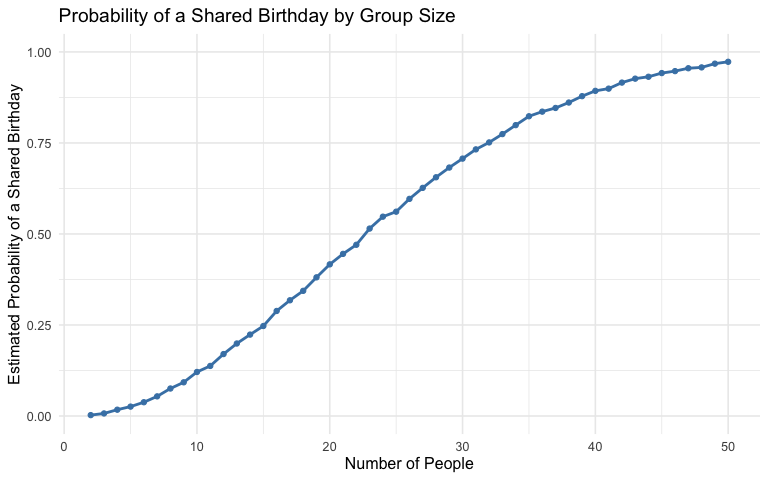
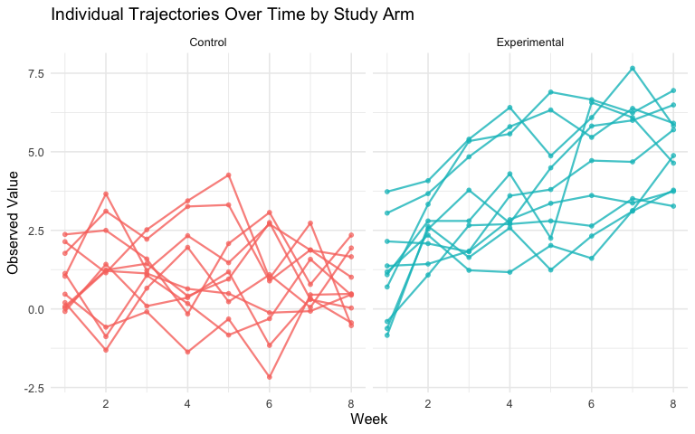
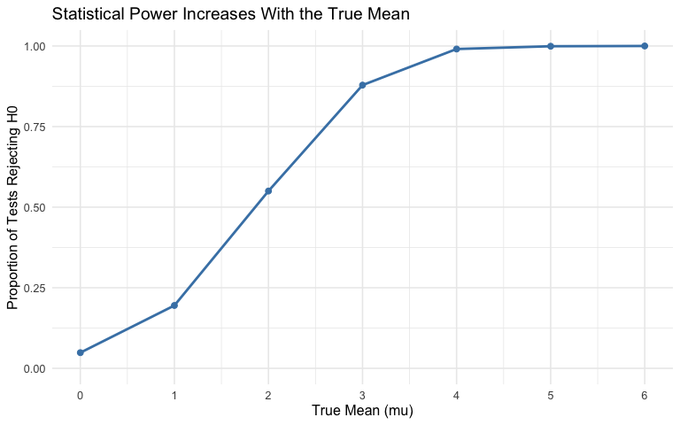
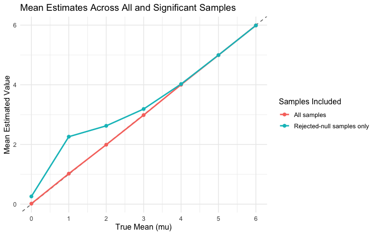

P8105 Homework 5
================
Cecilia Zhu

# Problem 1: Birthday simulation

The following function samples birthdays uniformly from the 365 days of
the year and returns `TRUE` when at least two people share a birthday.

``` r
shared_birthday = function(group_size) {
  birthdays = sample(1:365, size = group_size, replace = TRUE)
  any(duplicated(birthdays))
}

set.seed(8105)

birthday_results = tibble(group_size = 2:50) |>
  mutate(
    probability = map_dbl(
      group_size,
      ~ mean(replicate(10000, shared_birthday(.x)))
    )
  )

birthday_results
```

    ## # A tibble: 49 × 2
    ##    group_size probability
    ##         <int>       <dbl>
    ##  1          2      0.0024
    ##  2          3      0.007 
    ##  3          4      0.0173
    ##  4          5      0.0258
    ##  5          6      0.0378
    ##  6          7      0.0539
    ##  7          8      0.0755
    ##  8          9      0.0925
    ##  9         10      0.121 
    ## 10         11      0.138 
    ## # ℹ 39 more rows

``` r
birthday_results |>
  ggplot(aes(x = group_size, y = probability)) +
  geom_line(linewidth = 1, color = "steelblue") +
  geom_point(size = 1.5, color = "steelblue") +
  scale_y_continuous(limits = c(0, 1)) +
  labs(
    title = "Probability of a Shared Birthday by Group Size",
    x = "Number of People",
    y = "Estimated Probability of a Shared Birthday"
  ) +
  theme_minimal(base_size = 12)
```

<!-- -->

The probability of at least one shared birthday increases quickly with
group size. It becomes approximately 50% with only 23 people, and is
above 90% for groups of roughly 41 people. This seemingly surprising
result occurs because the number of possible pairs increases rapidly as
the group grows.

# Problem 2: Longitudinal study

Each subject has a separate CSV file. I first list the files, then use
`purrr::map()` to read each file, and finally reshape the weekly
observations into tidy form.

``` r
subject_data = tibble(
  file_path = list.files(
    path = "data",
    pattern = "\\.csv$",
    full.names = TRUE
  )
) |>
  mutate(
    file_name = basename(file_path),
    data = map(file_path, ~ read_csv(.x, show_col_types = FALSE))
  )

longitudinal_data = subject_data |>
  mutate(
    file_id = str_remove(file_name, "\\.csv$"),
    arm = str_extract(file_id, "^(con|exp)"),
    subject_id = str_extract(file_id, "[0-9]+$")
  ) |>
  select(arm, subject_id, data) |>
  unnest(data) |>
  pivot_longer(
    cols = matches("^week_?\\d+$"),
    names_to = "week",
    values_to = "observation"
  ) |>
  mutate(
    arm = recode(arm, con = "Control", exp = "Experimental"),
    week = readr::parse_number(week),
    subject = paste(arm, subject_id, sep = "_")
  ) |>
  select(subject, subject_id, arm, week, observation) |>
  arrange(arm, subject_id, week)

longitudinal_data
```

    ## # A tibble: 160 × 5
    ##    subject    subject_id arm      week observation
    ##    <chr>      <chr>      <chr>   <dbl>       <dbl>
    ##  1 Control_01 01         Control     1        0.2 
    ##  2 Control_01 01         Control     2       -1.31
    ##  3 Control_01 01         Control     3        0.66
    ##  4 Control_01 01         Control     4        1.96
    ##  5 Control_01 01         Control     5        0.23
    ##  6 Control_01 01         Control     6        1.09
    ##  7 Control_01 01         Control     7        0.05
    ##  8 Control_01 01         Control     8        1.94
    ##  9 Control_02 02         Control     1        1.13
    ## 10 Control_02 02         Control     2       -0.88
    ## # ℹ 150 more rows

``` r
longitudinal_data |>
  ggplot(aes(x = week, y = observation, group = subject, color = arm)) +
  geom_line(alpha = 0.8, linewidth = 0.8) +
  geom_point(alpha = 0.7, size = 1.3) +
  facet_wrap(~ arm) +
  labs(
    title = "Individual Trajectories Over Time by Study Arm",
    x = "Week",
    y = "Observed Value",
    color = "Study Arm"
  ) +
  theme_minimal(base_size = 12) +
  theme(legend.position = "none")
```

<!-- -->

The spaghetti plot shows clear differences in longitudinal trends
between the control and experimental groups. Observations in the control
group fluctuate around relatively low values without a consistent upward
or downward trend. In contrast, most subjects in the experimental group
show increasing observations over the eight-week period, with
substantially higher values toward the end of the study. Although
individual trajectories vary within both groups, the overall pattern
suggests that the experimental condition is associated with an increase
in the observed outcome over time.

# Problem 3: Simulation of t-test power

I use a sample size of 30, standard deviation of 5, significance level
of 0.05, and 5,000 simulated datasets for each true mean from 0 to 6.

``` r
set.seed(8105)

simulate_t_test = function(true_mu, n = 30, sigma = 5) {
  sample_data = rnorm(n = n, mean = true_mu, sd = sigma)
  t.test(sample_data, mu = 0) |>
    broom::tidy() |>
    select(estimate, p.value)
}

simulation_results = tibble(true_mu = 0:6) |>
  mutate(
    results = map(
      true_mu,
      ~ map_dfr(seq_len(5000), function(i) simulate_t_test(.x))
    )
  ) |>
  unnest(results) |>
  mutate(rejected = p.value < 0.05)

simulation_summary = simulation_results |>
  group_by(true_mu) |>
  summarize(
    power = mean(rejected),
    average_estimate = mean(estimate),
    average_rejected_estimate = if (any(rejected)) {
      mean(estimate[rejected])
    } else {
      NA_real_
    },
    .groups = "drop"
  )

simulation_summary
```

    ## # A tibble: 7 × 4
    ##   true_mu  power average_estimate average_rejected_estimate
    ##     <int>  <dbl>            <dbl>                     <dbl>
    ## 1       0 0.0486           0.0157                     0.258
    ## 2       1 0.195            1.02                       2.26 
    ## 3       2 0.55             1.99                       2.62 
    ## 4       3 0.879            2.98                       3.19 
    ## 5       4 0.991            4.00                       4.02 
    ## 6       5 0.999            4.99                       5.00 
    ## 7       6 1                5.99                       5.99

## Statistical power

``` r
simulation_summary |>
  ggplot(aes(x = true_mu, y = power)) +
  geom_line(linewidth = 1, color = "steelblue") +
  geom_point(size = 2, color = "steelblue") +
  scale_x_continuous(breaks = 0:6) +
  scale_y_continuous(limits = c(0, 1)) +
  labs(
    title = "Statistical Power Increases With the True Mean",
    x = "True Mean (mu)",
    y = "Proportion of Tests Rejecting H0"
  ) +
  theme_minimal(base_size = 12)
```

<!-- -->

When the true mean is zero, the rejection rate is close to the nominal
significance level of 0.05. As the true mean moves further from zero,
the test becomes more likely to reject the null hypothesis, so
statistical power increases.

## Estimated means in all and significant samples

``` r
simulation_summary |>
  select(true_mu, average_estimate, average_rejected_estimate) |>
  pivot_longer(
    cols = c(average_estimate, average_rejected_estimate),
    names_to = "sample_type",
    values_to = "mean_estimate"
  ) |>
  mutate(
    sample_type = recode(
      sample_type,
      average_estimate = "All samples",
      average_rejected_estimate = "Rejected-null samples only"
    )
  ) |>
  ggplot(aes(x = true_mu, y = mean_estimate, color = sample_type)) +
  geom_abline(intercept = 0, slope = 1, linetype = "dashed", color = "gray40") +
  geom_line(linewidth = 1) +
  geom_point(size = 2) +
  scale_x_continuous(breaks = 0:6) +
  labs(
    title = "Mean Estimates Across All and Significant Samples",
    x = "True Mean (mu)",
    y = "Mean Estimated Value",
    color = "Samples Included"
  ) +
  theme_minimal(base_size = 12)
```

<!-- -->

Across all simulated samples, the mean estimate is close to the true
mean because the sample mean is an unbiased estimator. Among only the
samples that reject the null, however, the average estimate can be
larger than the true positive mean, especially when power is low.
Statistical significance selects samples with unusually large estimated
effects, which creates a selection bias (sometimes called a winner’s
curse). At a true mean of zero, significant results can occur in both
directions, so the signed average may still be close to zero even though
the selected estimates have unusually large magnitudes.
